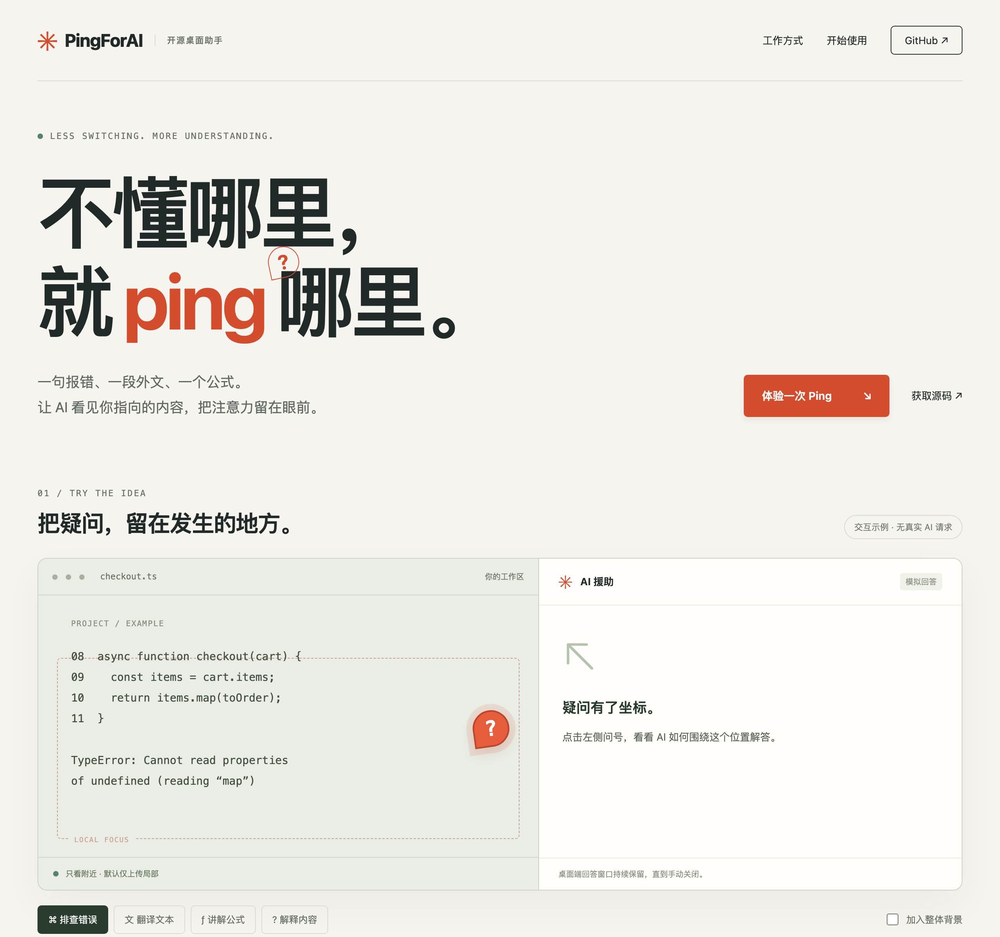

# PingForAI

把桌面信号变成 AI 提问入口：在看不懂的内容附近 ping 一个问号，即可截图并获取解释。



PingForAI 基于 [darrenprx/lolPing](https://github.com/darrenprx/lolPing) 开发，原作者为 Danrui Meng。我们保留原项目的桌面轮盘、信号、声音、表情和房间功能，增加按信号配置的 AI 截图援助。这是独立维护的衍生项目。

## AI 援助

- 每个信号可分别设置提示词，选择关闭、显示回答、复制回答或显示并复制。
- 默认问号信号启用显示回答，其余信号关闭；可在设置中调整。
- 内置解释、翻译、排查错误、讲解公式四种任务模板，可按信号分别应用并继续编辑，保留自己的提示词。
- 默认仅上传信号附近的局部截图，在本机裁剪后发送；可选 384×288、640×480、960×720 三档区域（实际尺寸受屏幕大小限制）。
- 需要上下文时可额外开启当前显示器整体背景图。此时提示模型约 80% 关注附近内容、20% 参考整体，提供信号在局部图中的准确坐标；这是提示词优先级，不是模型可保证的精确权重。关闭背景时只分析局部。
- 回答支持 Markdown 标题、列表、代码块和表格。每次回答使用独立窗口，直到手动关闭；可选择文字及复制原始 Markdown。
- API Key、模型和聊天接口地址可在「AI 援助」设置页配置。密钥由 Electron safeStorage 在本机加密保存，不传给页面；操作系统不支持加密时拒绝保存密钥。
- 截图和请求阶段有状态提示；请求进行中会拦截重复触发，失败后释放锁，可在冷却结束后重试。

## 展示页面

独立设计的中文展示页含四种任务切换和截图范围演示，适配手机与桌面。页面使用预设回答，不读取屏幕、不上传图片、不需要 API Key。

```sh
npm run dev:site    # 本地交互预览
npm run build:site  # 输出到 site-dist，可部署到静态网站服务
npm run media       # 用 Electron 生成 README 展示图
```

实际 AI 功能运行在桌面端；展示页与桌面端共用任务标识，示例回答不代表实际模型效果。

## 本地运行

需要 Node.js 22.16+（或支持 `--env-file-if-exists` 的更新版本）、npm，以及编译原生输入助手所需的 Swift/macOS 开发工具或 Windows C++ 工具链。

```sh
git clone https://github.com/ju-sir/PingForAI.git
cd PingForAI
npm ci
npm run build:helper
npm run dev
```

macOS 需要授予辅助功能权限以监听输入；AI 截图还需要屏幕录制权限。权限由系统管理，授权后可能需要重启应用。当前默认 Electron 的系统要求以其发行说明为准；macOS 12 可通过 `.env` 的 `ELECTRON_EXEC_PATH` 指向兼容的 Electron 37 可执行文件。本地已在 macOS 12 Intel 环境使用该方式验证；默认 macOS 打包目标仍是 arm64。

## 连接 AI

推荐启动后在设置页填写：

| 配置 | 示例 |
| --- | --- |
| 聊天接口地址 | `https://api.deepseek.com/chat/completions` |
| 模型 | `deepseek-flash` |
| API Key | 你自己的服务商密钥 |

服务和模型必须接受 OpenAI 风格的 `chat/completions` 请求及 `image_url` 输入，开启整体背景时还需支持多图。图像生成接口 `/images/generations` 不能直接替代读图聊天接口。不同服务的视觉能力、可用模型和计费方式以服务商实际支持为准。

也可将 [.env.example](.env.example) 复制为 `.env`，填写 `AI_API_KEY`、`AI_CHAT_ENDPOINT`、`AI_MODEL`。已在设置页保存的配置优先；在设置中明确清除密钥后不会退回环境变量继续发送。不要提交真实密钥。

## 数据与隐私

启用了 AI 的信号会把局部截图上传到你配置的 AI 服务；整体背景默认关闭，仅在你开启后额外上传当前显示器的缩小背景图。更新后也默认采用局部范围，不会改变已有提示词和信号动作。截图可能包含文档、聊天记录等敏感内容，只在愿意上传时启用；其他显示器不会作为 AI 图片发送。截图不另存到磁盘，AI 请求不经 PingForAI 自建服务器转发，API Key 不包含在房间消息中。当前请求冷却为 8 秒，超时为 60 秒。

模型输出视为不可信内容：Markdown 渲染会移除脚本、事件属性、图片和可执行链接。AI 可能误读画面，请自行核对答案。

## 开发验证

```sh
npm run typecheck
npm test -- --maxWorkers=2 --testTimeout=20000
npm run test:ai     # AI 核心与展示页专项覆盖率，四项指标门槛均为 80%
npm run build
npm run test:helper  # 修改原生输入助手时
```

`npm start` 运行已构建的应用。`npm run build:site` 构建项目网站。仓库不包含可直接安装的已签名发行包；本地构建与发行配置见 `package.json`。

本轮验证范围与环境见 [测试记录](docs/testing/ai-focus-2026-10-15.md)。

## 来源与许可证

原始代码和本项目修改采用 MIT 许可证，完整保留原作者版权声明，见 [LICENSE](LICENSE) 与 [NOTICE.md](NOTICE.md)。英雄联盟信号贴图与声音属于 Riot Games，不在代码的 MIT 授权范围内。本项目未获 Riot Games 背书。

房间协议中的 `lolping/room/v1` 标识为兼容性保留，旧 `lolPing` 配置目录仅用于迁移个人设置。贡献和上游提交流程见 [CONTRIBUTING.md](CONTRIBUTING.md)。
